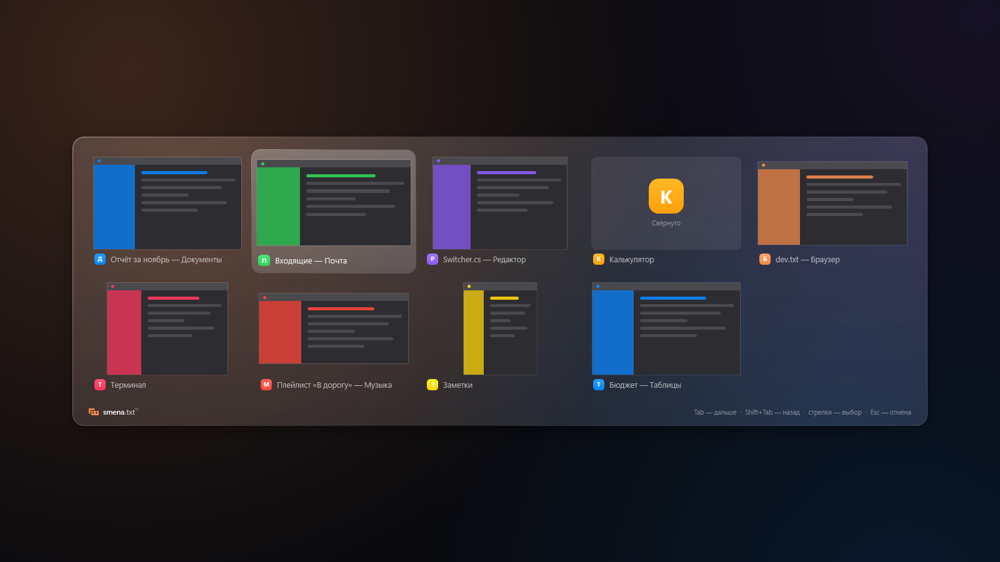

# smena.txt

Переключатель окон dev.txt™ вместо системного Alt+Tab: стеклянная панель по центру экрана с живыми превью окон. Живёт в трее, настройки — на общей странице в core.txt.



На снимках вместо живых превью — условные «окна»: настоящие превью Windows рисует сама прямо на экране, в файл они не попадают.

## Что делает

- Перехватывает Alt+Tab и показывает свои карточки окон: живое превью (DWM), значок и заголовок. Порядок — от недавнего к давнему; окно, в котором вы сейчас, стоит первым, выбор начинается с предыдущего.
- Панель появляется на том мониторе, где окно, с которым вы работаете. Если окон много, карточки идут в несколько рядов поровну; не поместившиеся ряды прокручиваются вслед за выбором.
- Свёрнутые окна показываются плиткой с крупным значком: живого превью у них нет. При переключении разворачиваются.
- При «Меньше движения» (настройка Windows или общая настройка в core.txt) всё появляется сразу, без движения.

## Клавиши

| Клавиши | Что происходит |
|---|---|
| Alt+Tab | открыть и идти вперёд |
| Alt+Shift+Tab | идти назад |
| стрелки, пока зажат Alt | выбор по карточкам и рядам |
| отпустить Alt или Enter | перейти в выбранное окно |
| Esc | отмена |
| щелчок по карточке | перейти в это окно |
| щелчок мимо панели | отмена |
| Alt+` (клавиша над Tab) | то же, но только окна программы, в которой вы сейчас |

Ctrl+Alt+Tab и Win+Tab остаются системными.

## Трей

- **Настройки** — открывает core.txt (там общая страница настроек). Если core.txt не запущен — окно «О программе», где это сказано.
- **Приостановить** — перехватчик клавиш снимается, работает обычный Alt+Tab. До следующего запуска не запоминается.
- **О программе** — состояние и кнопка «Показать»: переключатель открывается без клавиатуры и ждёт щелчка, Enter или Esc.
- **Выход**.

## Настройки

Публикуются в хаб как `smena.settings`, меняются командой `settings.set`.

| Ключ | Настройка | По умолчанию |
|---|---|---|
| `replace` | Заменять Alt+Tab | да |
| `sameApp` | Alt+` — окна того же приложения | да |
| `games` | Не вмешиваться в играх | да |
| `allDesktops` | Показывать окна со всех рабочих столов | нет |
| `size` | Размер превью, 160–360 с шагом 20 | 240 |

Команда `show` один раз показывает переключатель в режиме «до щелчка». Из `hub.theme` читается `reducedMotion`.

### Игры и античиты

Чтобы забрать Alt+Tab у системы, приложение ставит низкоуровневый перехватчик клавиатуры (`WH_KEYBOARD_LL`). Некоторые античиты в играх считают такие перехватчики подозрительными. Поэтому есть «Не вмешиваться в играх»: когда впереди окно на весь монитор без заголовка, Alt+Tab остаётся системным. Сам перехватчик при этом установлен. Если нужно, чтобы его не было вовсе, выберите «Приостановить» в трее или выключите «Заменять Alt+Tab»: в обоих случаях перехватчик снимается.

Перехватчик на каждую клавишу только решает, наша ли она, и передаёт действие окну; клавиши никуда не записываются и не отправляются.

## Сборка

```bash
powershell -ExecutionPolicy Bypass -File build.ps1
```

Ничего ставить и скачивать не нужно. Получается один файл `Smena.exe`. Номер версии — в `version.txt`. Значок файла собирается из `sprite.json`: `node tools/icon.js`.

## Проверка

```bash
./Smena.exe --selftest
./Smena.exe --demo --shot shot.png --count 9
```

| Ключ | Что делает |
|---|---|
| `--selftest` | отбор и порядок окон, движение выбора, клавиши (тем же кодом, что вызывает перехватчик), правило «не вмешиваться», ряды и прокрутка, место превью, настройки и `settings.set`, работа без хаба |
| `--demo` | выдуманные окна на экране; перехватчик, хаб, диск и настоящие окна не трогаются. Щелчок или Esc — выход |
| `--shot файл.png` | рисует переключатель с выдуманными окнами в файл и выходит. `--count N` — сколько окон, `--select N` — какое выбрано, `--sticky` — подсказка как при показе командой, `--size ШxВ` — размер «экрана», `--about` — окно «О программе» |
| `--headless` | без трея и окон: только связь с хабом. Перехватчик не ставится, `show` считает окна, но ничего не показывает |
| `--no-hook` | обычный запуск без перехватчика клавиш; переключатель открывается только командой `show` и кнопкой «Показать» |
| `--probe [файл]` | считает настоящие окна, заводит живое превью первого на спрятанном окне, пишет одну строку и выходит |

Проверка связи без настоящего core.txt — с образцовым хабом из kit.txt на свободном порту:

```bash
node путь/к/kit.txt/hub/hub.js 48991
SMENA_HUB_PORT=48991 SMENA_DATA=./tmp-data ./Smena.exe --no-hook --headless
```

`SMENA_HUB_PORT` — порт хаба вместо 42080, `SMENA_DATA` — папка настроек вместо `%APPDATA%\dev.txt\smena`.

## Как это устроено

| Файл | Что это |
|---|---|
| `src/Program.cs` | запуск, ключи, трей, настройки (`Prefs`) |
| `src/Model.cs` | всё без Windows: отбор окон, выбор, клавиши (`KeyMachine`), ряды, прокрутка, место превью |
| `src/Hook.cs` | перехватчик клавиатуры в своём потоке |
| `src/Win.cs` | окна, значки, живые превью, вывод окна вперёд, рабочие столы |
| `src/Switcher.cs` | окно переключателя и выдуманные окна для снимков |
| `src/About.cs` | окно «О программе» |
| `src/AppHub.cs` | связь с хабом |
| `src/SelfTest.cs` | проверки |
| `src/Tokens.cs`, `src/Ui.cs`, `src/HubLink.cs` | **копии из kit.txt, руками не правятся**; обновляются `tools/sync.ps1 путь\к\kit.txt` |

Как окно выводится вперёд (`Win.Activate`): сначала обычный `SetForegroundWindow`; если Windows отказала — пустое нажатие несуществующей клавиши (после него последний ввод считается нашим) и вторая попытка; если и это не помогло — `AttachThreadInput` к очереди переднего окна и третья. То же пустое нажатие посылается при открытии, чтобы программа под панелью не открыла своё меню, когда Alt отпустят.

Окна других рабочих столов определяются описанным в документации `IVirtualDesktopManager`.

## Ограничения

- Превью прямоугольные и всегда лежат поверх панели: их рисует Windows, скруглить или накрыть их нельзя.
- Пока впереди окно программы, запущенной от имени администратора, Windows не отдаёт нам клавиши: там работает системный Alt+Tab. Переключиться в такое окно можно, из него — нет.
- Окна «поверх всех» стоят в порядке Windows выше остальных, даже если ими давно не пользовались.
- На мониторах с разным масштабом панель на втором мониторе может быть слегка размыта.
- У части приложений из Магазина значок может не найтись — тогда вместо него плитка с буквой.
- «Не вмешиваться в играх» срабатывает на любое окно на весь монитор без заголовка, в том числе на видео во весь экран.
- Автозапуска нет.

## Не проверено

Проверено без экрана: `--selftest`, снимки, обмен с образцовым хабом, счёт настоящих окон и регистрация живого превью на спрятанном окне. На живой машине **не проверялось**:

- сам перехватчик клавиатуры — он ни разу не ставился; проверена только логика клавиш, которую он вызывает;
- живые превью на экране: что они видны на прозрачном окне, стоят на местах и двигаются вместе с карточками;
- настоящее переключение окон, в том числе разворачивание свёрнутых и запасные способы вывода вперёд;
- появление и движение подсветки на экране, трей и его меню;
- окна с других рабочих столов (настройка `allDesktops`) и переход на другой стол;
- повторная установка перехватчика после сна и разблокировки.

## Значок

Две карточки окон, одна поверх другой; у передней — глаза. Строки — в `sprite.json` и в `Program.Sprite`.

```
#######.....
#######.....
##..........
##.#########
##.##E###E##
##.##E###E##
...#########
...#########
```

Чтобы значок попал в общий набор, его нужно добавить в `icons/sprites.json` в kit.txt.

## Как попасть в core.txt

Одной записью в `catalog.json` репозитория core.txt:

```json
{
  "id": "smena",
  "name": "Smena",
  "tagline": "Переключатель окон вместо Alt+Tab с живыми превью",
  "color": "#F08A4B",
  "kind": "portable",
  "repo": "cxxperman/smena",
  "asset": "Smena.exe",
  "exe": "Smena.exe",
  "process": "Smena",
  "sprite": ["#######.....", "#######.....", "##..........", "##.#########", "##.##E###E##", "##.##E###E##", "...#########", "...#########"]
}
```

Релиз делает `.github/workflows/build.yml`: номер в `version.txt` и тег `v` с тем же номером.
